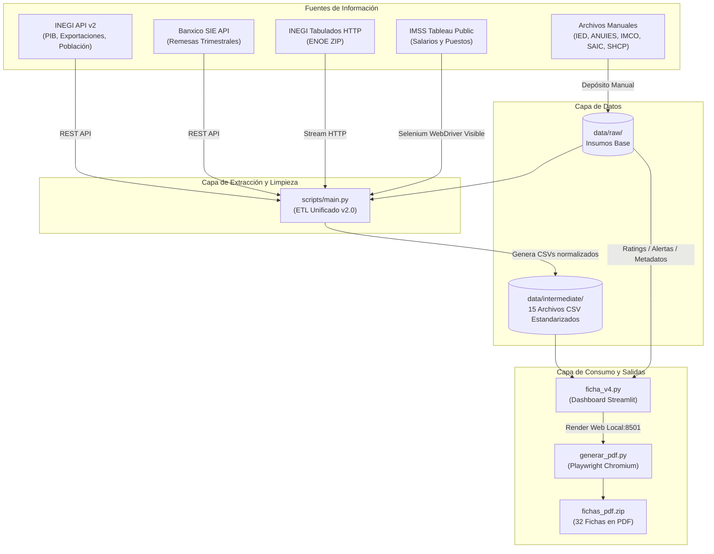
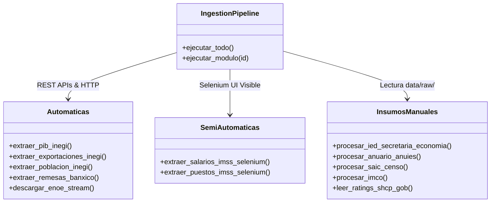

# 🇲🇽 Plataforma de Fichas Técnicas Estatales — Bancomext / NAFIN

> **Guía Integral de Arquitectura, Operación, Mantenimiento y Extracción de Datos (ETL)**  
> *Documento maestro para transferencia de conocimiento, relevo técnico y operación continua.*

---

## 📌 Tabla de Contenidos
1. [Propósito y Alcance del Proyecto](#1-propósito-y-alcance-del-proyecto)
2. [Arquitectura General del Sistema](#2-arquitectura-general-del-sistema)
3. [Inventario Completo del Repositorio (Producción vs. Legado)](#3-inventario-completo-del-repositorio)
4. [Taxonomía de Fuentes e Ingestión de Datos (ETL)](#4-taxonomía-de-fuentes-e-ingestión-de-datos-etl)
   - [4.1 Consultas 100% Automáticas (APIs / Web Scraping HTTP)](#41-consultas-100-automáticas)
   - [4.2 Consultas Semi-Automáticas (Selenium / Tableau Public)](#42-consultas-semi-automáticas-selenium)
   - [4.3 Insumos Manuales Requeridos en `data/raw/`](#43-insumos-manuales-requeridos-en-dataraw)
5. [Guía de Instalación y Configuración del Entorno](#5-guía-de-instalación-y-configuración-del-entorno)
6. [Manual de Operación: Paso a Paso para Actualizaciones](#6-manual-de-operación-paso-a-paso)
7. [Visualización y Generación de Entregables](#7-visualización-y-generación-de-entregables)
   - [Dashboard Streamlit (`ficha_v4.py`)](#dashboard-streamlit-ficha_v4py)
   - [Generación Masiva de PDFs (`generar_pdf.py` y GitHub Actions)](#generación-masiva-de-pdfs)
8. [Matriz de Archivos Intermedios (`data/intermediate/`)](#8-matriz-de-archivos-intermedios)
9. [Resolución de Problemas Frecuentes (Troubleshooting)](#9-resolución-de-problemas-frecuentes-troubleshooting)

---

## 1. Propósito y Alcance del Proyecto

Este repositorio contiene la solución tecnológica integral para la recopilación, procesamiento, análisis y presentación de las **Fichas Técnicas Estatales de México** para **Bancomext y NAFIN**. 

La solución centraliza más de 12 dimensiones socioeconómicas, financieras, comerciales y laborales para las 32 entidades federativas (más el consolidado Nacional), permitiendo a directivos y analistas evaluar el perfil económico, la vocación industrial, el clima de negocios y la solvencia financiera de cada estado.

### Capacidades Principales
- **Pipeline ETL Unificado (`scripts/main.py`)**: Orquesta la extracción de datos desde INEGI, Banxico, IMSS, Secretaría de Economía, ANUIES, IMCO y SHCP.
- **Dashboard Ejecutivo Interactivo (`ficha_v4.py`)**: Aplicación en Streamlit con diseño institucional, mapas coropléticos interactivos, análisis de variaciones anuales/trimestrales, pirámides poblacionales y perfiles de deuda subnacional.
- **Motor de Compilación PDF (`generar_pdf.py`)**: Automatización basada en Playwright que exporta fichas técnicas individuales en alta resolución listas para impresión o distribución institucional.

---

## 2. Arquitectura General del Sistema

El flujo de información sigue un modelo desacoplado en tres capas: **Ingestión (Raw)** $\rightarrow$ **Transformación (Intermediate)** $\rightarrow$ **Consumo (Streamlit / PDF)**:



---

## 3. Inventario Completo del Repositorio

> [!IMPORTANT]
> El repositorio contiene archivos de desarrollo temprano y prototipos que **NO deben ejecutarse ni modificarse**. A continuación se detalla con precisión el rol de cada archivo.

### 🟢 Archivos de Producción (Activos y Críticos)

| Archivo / Directorio | Tipo | Función |
| :--- | :--- | :--- |
| `scripts/main.py` | Python Script | **Orquestador Principal del ETL (v2.0 Blindado)**. Maneja la extracción de los 11 módulos, rotación de tokens, concurrencia, reintentos y generación de datos intermedios. |
| `ficha_v4.py` | Python Script | **Dashboard Streamlit Oficial**. Contiene la versión definitiva de la interfaz visual, cálculos de KPIs, mapas GeoJSON y visualizaciones Plotly institucionales. |
| `generar_pdf.py` | Python Script | **Generador Automatizado de PDFs**. Usa Playwright (Chromium) para navegar por cada estado en `localhost:8501`, inyectar estilos de impresión limpios y compilar los 32 PDFs en `fichas_pdf.zip`. |
| `app.py` | Python Script | Lanzador genérico para servidores cloud. Permite conmutar la versión activa modificando la variable `VERSION_ACTUAL` (actualmente configurada para redirigir a la versión activa). |
| `data/raw/` | Directorio | Almacena los insumos base, catálogos históricos y archivos manuales requeridos por el ETL y por el dashboard. |
| `data/intermediate/` | Directorio | Contiene los **15 CSVs normalizados** generados por `scripts/main.py` y consumidos por `ficha_v4.py`. |
| `logos/` | Directorio | Logotipos institucionales oficiales (`logo-01.png`, `logo-02.png`) utilizados en los encabezados del dashboard y reportes. |
| `.streamlit/config.toml` | Configuración | Define la paleta de colores institucional (`#2596be`, `#0F172A`, `#F8FAFC`) y tipografía del dashboard. |
| `.github/workflows/generar_pdfs.yml` | CI/CD Workflow | Automatización en GitHub Actions que regenera los PDFs y actualiza el ZIP si detecta cambios en datos. |
| `requirements.txt` | Configuración | Dependencias base para ejecutar el dashboard Streamlit. |

---

### 🔴 Archivos Históricos y Obsoletos (NO Usar / Conservar Solo como Historial)

| Archivo | Motivo de Obsolescencia |
| :--- | :--- |
| `scripts/main_legacy.py` | Versión 1 original del ETL. Reemplazada por `scripts/main.py` debido a fragilidad en selectores de Tableau, falta de manejo atómico de descargas y ausencia de ordenamiento determinista en Git. |
| `scripts/main.ipynb` | Jupyter Notebook donde se desarrollaron los primeros borradores del ETL. |
| `scripts/*.ipynb` | Notebooks individuales exploratorios (`anuario_entidad.ipynb`, `pib_entidad.ipynb`, `salarios_imss_entidad.ipynb`, etc.) usados durante la fase de análisis. Su código consolidado reside en `scripts/main.py`. |
| `scripts/parrafos_pib_exp.py` / `.ipynb` | Prototipo experimental para redacción automatizada de textos narrativos. No forma parte del pipeline activo. |
| `ficha.py`, `ficha_test.py`, `ficha_v2.py`, `ficha_v3.py` | Versiones preliminares del dashboard. Toda su funcionalidad y correcciones visuales se consolidaron en `ficha_v4.py`. |
| `data/raw/calendario_actualización_2026.xlsx` | Archivo Excel preliminar de fechas; fue sustituido por el archivo estructurado `data/raw/fechas_actualizacion.json`. |
| `data/raw/ratings_estatales.xlsx` | Formato previo de calificaciones crediticias; sustituido por `data/raw/ratings_historicos.xlsx`. |
| `data/raw/base_anuario.xlsx` | Versión previa del anuario educativo; superada por `data/raw/base_anuario_2024-2025.xlsx`. |
| `data/raw/2025_4T_...` / `2026_1T_...` | Reportes trimestrales anteriores de IED; el script detecta automáticamente el trimestre más nuevo (`2026_2T_...`). |

---

## 4. Taxonomía de Fuentes e Ingestión de Datos (ETL)

El script `scripts/main.py` clasifica sus tareas en tres metodologías operativas:



---

### 4.1 Consultas 100% Automáticas

Estas consultas se ejecutan directamente vía red mediante peticiones HTTP estructuradas o REST APIs:

1. **PIB Estatal — INEGI API v2**
   - **Mecanismo**: Peticiones concurrentes (`ThreadPoolExecutor`) utilizando un pool rotativo de tokens de la API de Indicadores de INEGI.
   - **Salida**: `data/intermediate/pib_entidad.csv`.
   - **Mantenimiento**: Si los tokens expiran o son rechazados, actualice la lista `INEGI_TOKENS` en `scripts/main.py`.

2. **Exportaciones Trimestrales — INEGI API v2**
   - **Mecanismo**: Consulta detallada por entidad y subsectores de manufactura / minería.
   - **Salida**: `data/intermediate/exportaciones_entidad.csv`.

3. **Población y Pirámide Quinquenal — INEGI API v2**
   - **Mecanismo**: Peticiones sobre las series del Censo de Población (desglose por grupos de edad y sexo).
   - **Salida**: `data/intermediate/poblacion_edad.csv`.

4. **Remesas Familiares Trimestrales — Banxico SIE API**
   - **Mecanismo**: Consulta al Sistema de Información Económica de Banxico con token institucional. Incluye cálculo de variaciones anuales y filtrado automático de trimestres futuros sin registro oficial.
   - **Salida**: `data/intermediate/remesas_entidad.csv`.
   - **Mantenimiento**: Token configurable en la variable `BANXICO_TOKEN` de `scripts/main.py`.

5. **Encuesta Nacional de Ocupación y Empleo (ENOE) — INEGI Tabulados**
   - **Mecanismo**: Descarga directa de archivos ZIP desde los servidores de INEGI. Utiliza detección por streaming HTTP (`stream=True`) para verificar encabezados MIME reales (`application/x-zip-compressed`), descomprime en memoria y extrae indicadores de desocupación e informalidad laboral.
   - **Salida**: `data/intermediate/enoe_indicadores.csv`.

---

### 4.2 Consultas Semi-Automáticas (Selenium)

> [!CAUTION]
> **REGLA ESTRICTA DE OPERACIÓN**:  
> **NUNCA ejecute los módulos de IMSS en modo Headless (oculto)**.  
> Los tableros de Tableau Public utilizados por el IMSS detectan y bloquean entornos headless, o bien fallan al renderizar los micro-elementos del canvas interactivo y el árbol DOM. El procesamiento **DEBE SER VISIBLE**.

1. **Salarios IMSS (Salario Base de Cotización por Entidad)**:
   - **URL**: [Tablero de Salarios IMSS en Tableau Public](https://public.tableau.com/views/Ta-Salarios_16849479704770/Cifrasdesalario)
   - **Mecanismo**: 
     1. Abre una ventana de Google Chrome automatizada.
     2. Rechaza o cierra el banner de consentimiento de cookies.
     3. Selecciona la pestaña *"Cifras de salario"*.
     4. Abre el menú desplegable de entidades federativas y deselecciona `(All)`.
     5. Marca secuencialmente cada uno de los 32 estados, descarga el archivo CSV temporal y lo renombra de forma atómica a `Salario_{estado}.csv`.
     6. Al completar los 32 estados, cierra Chrome y consolida todos los archivos en `data/intermediate/salarios_imss.csv`.
   - **Mecanismo de Reintento Blindado**: Si la conexión se interrumpe y falta algún estado, el script cierra Chrome, abre una nueva sesión limpia únicamente para los estados faltantes y los une al lote final.

2. **Puestos de Trabajo Afiliados al IMSS**:
   - **URL**: Tablero de Puestos de Trabajo IMSS en Tableau Public.
   - **Mecanismo**: Descarga la estructura agregada de trabajadores asegurados (totales, permanentes y eventuales) a nivel estatal.
   - **Salida**: `data/intermediate/puestos_imss.csv`.

---

### 4.3 Insumos Manuales Requeridos en `data/raw/`

Estos archivos deben descargarse o actualizarse manualmente en la carpeta `data/raw/` cada vez que las dependencias oficiales publiquen nuevas cifras:

| Archivo en `data/raw/` | Fuente Oficial | Periodicidad | Formato y Detalle de Ingestión |
| :--- | :--- | :--- | :--- |
| `*Flujos_EF_OR*.xlsx`<br>*(Ej: `2026_2T_Flujos_EF_OR_11A.xlsx`)* | **Secretaría de Economía**<br>[Portal de IED](https://www.gob.mx/se/acciones-y-programas/inversion-extranjera-directa) | Trimestral | Descargar el archivo Excel de flujos por entidad federativa y sector. El script detecta automáticamente el archivo con el trimestre más reciente. Genera `ied_totales.csv` e `ied_top3_sectores.csv`. |
| `base_anuario_YYYY-YYYY.xlsx`<br>*(Ej: `base_anuario_2024-2025.xlsx`)* | **ANUIES**<br>[Anuarios Estadísticos de Educación Superior](http://www.anuies.mx/informacion-y-servicios/informacion-estadistica-de-educacion-superior/anuario-estadistico-de-educacion-superior) | Anual | Contiene matrícula y egresados por carrera universitaria. Genera `educacion_totales.csv`, `educacion_top3_matricula.csv` y `educacion_top3_egresados.csv`. |
| `SAIC.xlsx` | **INEGI — Censos Económicos**<br>[Sistema Automatizado de Información Censal](https://www.inegi.org.mx/app/saic/) | Quinquenal | Tabulado de Personal Ocupado Total (POT) y Valor Agregado Censal Bruto (VACB) por estado para el cálculo de productividad laboral. Genera `saic_productividad.csv`. |
| `imco_general.csv` y `imco_desagregado.csv` | **IMCO**<br>[Índice de Competitividad Estatal (ICE)](https://imco.org.mx/indices/indice-de-competitividad-estatal/) | Anual | Calificaciones generales y subíndices de competitividad. Genera `imco_general_final.csv` e `imco_desagregado_final.csv`. |
| `ratings_historicos.xlsx` | **Calificadoras de Riesgo**<br>(Fitch, Moody's, S&P, HR Ratings) | Eventual | Archivo manual con las calificaciones crediticias históricas y vigentes de las 32 entidades. Consumido directamente por `ficha_v4.py`. |
| `sistema_alertas.xlsx` | **SHCP**<br>[Sistema de Alertas de Deuda Subnacional](https://www.disciplinafinanciera.hacienda.gob.mx/) | Trimestral | Semáforo de endeudamiento institucional de estados y municipios. Consumido directamente por `ficha_v4.py`. |
| `gob_sedeco.xlsx` | **Bancomext / Red de Oficinas** | Eventual / Electoral | Catálogo de gobernadores, titulares de SEDECO, correos de contacto, periodos de gobierno y partidos políticos. Consumido por `ficha_v4.py`. |
| `fechas_actualizacion.json` | **Gestión Interna del Repositorio** | Continuo | Archivo JSON que documenta las fechas de última y próxima actualización de cada fuente. Se refleja en las notas al pie de cada ficha estatal. |

---

## 5. Guía de Instalación y Configuración del Entorno

### Requisitos Previos
- **Sistema Operativo**: Windows 10/11, macOS o Linux (desarrollado y optimizado originalmente para Windows).
- **Python**: Versión **3.10** o superior (probado en Python 3.10 a 3.14).
- **Navegador**: Google Chrome instalado en su ruta por defecto (requerido para Selenium).

### Instalación de Dependencias

Abra una terminal (PowerShell o CMD en Windows) en la raíz del repositorio y ejecute:

```powershell
# 1. Crear entorno virtual (Recomendado)
python -m venv venv
.\venv\Scripts\activate

# 2. Actualizar pip
python -m pip install --upgrade pip

# 3. Instalar librerías de producción (Dashboard y ETL)
pip install -r requirements.txt
pip install selenium webdriver-manager requests tqdm urllib3 openpyxl

# 4. Instalar Playwright y sus navegadores (Requerido solo para generar PDFs)
pip install playwright
playwright install chromium
```

---

## 6. Manual de Operación: Paso a Paso

### Paso 1: Actualización de Insumos Manuales
Antes de correr el procesamiento, verifique si hay nuevos datos publicados en:
1. **IED**: Si la Secretaría de Economía publicó un nuevo trimestre, descargue el archivo Excel a `data/raw/` (ejemplo: `2026_3T_Flujos_EF_OR_11A.xlsx`).
2. **Alertas / Ratings**: Actualice `data/raw/sistema_alertas.xlsx` o `data/raw/ratings_historicos.xlsx` si hubo movimientos crediticios.
3. **Calendario**: Actualice `data/raw/fechas_actualizacion.json` con las próximas fechas estimadas de publicación.

### Paso 2: Ejecución del Pipeline ETL

Ejecute el script orquestador:

```powershell
python scripts/main.py
```

El script mostrará un encabezado de estado y un menú interactivo:

```text
================================================================================
🚀 ETL ESTATAL UNIFICADO (v2.0 Blindado) - BANCOMEXT 🚀
================================================================================
📍 Raíz del Proyecto: C:\...\Bancomext\Estatales
📂 Datos Crudos:     C:\...\Bancomext\Estatales\data\raw
📂 Datos Procesados: C:\...\Bancomext\Estatales\data\intermediate
🔑 Tokens INEGI activos: 4
================================================================================

Seleccione los módulos a procesar (ej. 1,2,5 o 'all'):
   [1] PIB (INEGI)
   [2] Exportaciones (INEGI)
   [3] Población (INEGI)
   [4] ENOE (Descarga Excel)
   [5] Educación (Anuario)
   [6] IED (Estructura)
   [7] SAIC (Productividad)
   [8] IMCO (Competitividad)
   [9] Salarios IMSS (Selenium)
   [10] Puestos IMSS (Selenium)
   [11] Remesas (Banxico)
```

- Escriba `all` para procesar el ciclo completo (toma aproximadamente entre 10 y 15 minutos debido a las descargas de Selenium).
- O escriba los números separados por coma (ejemplo: `9,10` para actualizar únicamente IMSS).

> [!TIP]
> Durante la ejecución de los módulos 9 y 10, **verá abrirse la ventana de Chrome**. No interactúe con el mouse ni cierre la ventana mientras Selenium opera en Tableau Public.

---

## 7. Visualización y Generación de Entregables

### Dashboard Streamlit (`ficha_v4.py`)

Para explorar el tablero interactivo en su navegador local:

```powershell
streamlit run ficha_v4.py
```

El navegador se abrirá automáticamente en `http://localhost:8501`. Desde aquí podrá:
- Visualizar el mapa nacional con coropletas de indicadores económicos.
- Seleccionar cualquiera de los 32 estados desde la barra lateral.
- Comparar el desempeño estatal contra la media nacional.
- Analizar pirámides poblacionales, estructura educativa por carreras y vocación exportadora.

---

### Generación Masiva de PDFs

Hay dos formas de generar los 32 PDFs consolidados:

#### Opción A: Localmente en su equipo
1. En una primera terminal, levante Streamlit:
   ```powershell
   streamlit run ficha_v4.py --server.port 8501
   ```
2. En una segunda terminal, ejecute el generador:
   ```powershell
   python generar_pdf.py
   ```
3. El script recorrerá estado por estado, limpiará los elementos web (sidebars, botones de descarga), esperará el renderizado de gráficos Plotly y guardará los PDFs en `fichas_pdf/`, empaquetándolos finalmente en `fichas_pdf.zip`.

#### Opción B: Automáticamente vía GitHub Actions
El repositorio cuenta con el flujo automatizado `.github/workflows/generar_pdfs.yml`.
- Al realizar un `git push` a la rama `main` con cambios en la carpeta `data/`, GitHub levantará un contenedor Ubuntu, instalará Playwright, compilará los 32 PDFs y hará un `commit` automático con el nuevo `fichas_pdf.zip`.
- También puede dispararlo manualmente desde la pestaña **Actions** en GitHub seleccionando *"Actualizar PDFs de Fichas Estatales"* $\rightarrow$ *"Run workflow"*.

---

## 8. Matriz de Archivos Intermedios

Los 15 archivos generados en `data/intermediate/` alimentan directamente los módulos de `ficha_v4.py`:

| Archivo Intermedio | Indicador Asociado | Variables Clave |
| :--- | :--- | :--- |
| `pib_entidad.csv` | Producto Interno Bruto Estatal | Año, Entidad, Actividad Económica, Valor Millones MXN. |
| `exportaciones_entidad.csv` | Exportaciones Trimestrales | Año, Trimestre, Entidad, Subsector, Miles USD. |
| `poblacion_edad.csv` | Demografía y Pirámide Poblacional | Entidad, Grupo Quinquenal, Hombres, Mujeres, Total. |
| `enoe_indicadores.csv` | Mercado Laboral ENOE | Entidad, Tasa Desocupación, Tasa Informalidad, Trimestre. |
| `salarios_imss.csv` | Salario Base de Cotización (SBC) | Entidad, Periodo (Mes/Año), Salario Diario MXN. |
| `puestos_imss.csv` | Empleo Formal Registrado | Entidad, Periodo, Trabajadores Totales, Permanentes, Eventuales. |
| `remesas_entidad.csv` | Ingresos por Remesas | Entidad, Año, Trimestre, Millones USD, Variación % Anual. |
| `ied_totales.csv` | IED Total por Entidad | Año, Trimestre, Entidad, Flujo Neto Millones USD. |
| `ied_top3_sectores.csv` | Principales Sectores Receptores IED | Entidad, Subsector SCIAN (3 dígitos), Participación %. |
| `educacion_totales.csv` | Matrícula y Egresados Totales | Entidad, Ciclo Escolar, Total Matrícula, Total Egresados. |
| `educacion_top3_matricula.csv` | Carreras Universitarias más Cursadas | Entidad, Campo Amplio / Carrera, Número de Alumnos. |
| `educacion_top3_egresados.csv` | Carreras con Mayor Oferta de Egresados | Entidad, Campo Amplio / Carrera, Egresados Anuales. |
| `saic_productividad.csv` | Productividad Laboral Censal | Entidad, Personal Ocupado, Valor Agregado, Productividad. |
| `imco_general_final.csv` | Competitividad Estatal General | Entidad, Posición Ranking, Nivel de Competitividad. |
| `imco_desagregado_final.csv` | Subíndices de Competitividad | Entidad, Subíndice (Economía, Sociedad, Innovación, etc.), Score. |

---

## 9. Resolución de Problemas Frecuentes (Troubleshooting)

### 1. El web scraping de Salarios IMSS se atora o arroja `TimeoutException`
- **Causa**: Tableau Public ocasionalmente actualiza los IDs dinámicos de sus contenedores iframe o el servidor del IMSS experimenta alta latencia.
- **Solución**:
  - `scripts/main.py` ya cuenta con reintentos automáticos y selectores semánticos (`xpath` y `css`).
  - Verifique que su conexión a internet sea estable.
  - Compruebe que la versión de Google Chrome instalada sea compatible con su controlador. `webdriver-manager` gestiona esto en tiempo de ejecución.
  - Recuerde: **no minimice ni cierre la ventana de Chrome** durante el raspado.

### 2. Error 403 Forbidden o Cuota Excedida en APIs de INEGI
- **Causa**: INEGI limita el número de solicitudes por segundo por token.
- **Solución**:
  - `scripts/main.py` incluye un pool con 4 tokens activos y pausas adaptativas.
  - Si un token es revocado, solicite uno nuevo en el [Portal de Desarrolladores INEGI](https://www.inegi.org.mx/servicios/api_indicadores.html) y agréguelo a la lista `INEGI_TOKENS` en la sección de configuración de `scripts/main.py`.

### 3. Git detecta cambios masivos en los CSVs tras correr el ETL sin que haya datos nuevos
- **Causa**: Desorden aleatorio en los registros debido a la concurrencia (`ThreadPoolExecutor`).
- **Solución**:
  - En la versión `v2.0` de `scripts/main.py`, todos los módulos implementan un ordenamiento determinista (`.sort_values(by=[...])`) antes de guardar el CSV. Si no hay cifras nuevas en las fuentes, el hash de los archivos permanecerá idéntico y Git no reportará modificaciones falsas.

### 4. Al generar PDFs, Playwright no encuentra la app en `localhost:8501`
- **Causa**: El servidor de Streamlit no se levantó previamente o tardó más de 10 segundos en iniciar.
- **Solución**:
  - Verifique en su terminal que `streamlit run ficha_v4.py` esté mostrando `Network URL: http://...` y respondiendo en el navegador antes de ejecutar `python generar_pdf.py`.

---

## 🏛️ Créditos y Responsabilidad Institucional
- **Institución**: Banco Nacional de Comercio Exterior (Bancomext) / Nacional Financiera (NAFIN).
- **Área**: Dirección Adjunta de Financiamiento y Fomento / Estudios Económicos.
- **Estado del Código**: En producción, auditado y blindado contra fallos de concurrencia y cambios de interfaz.

